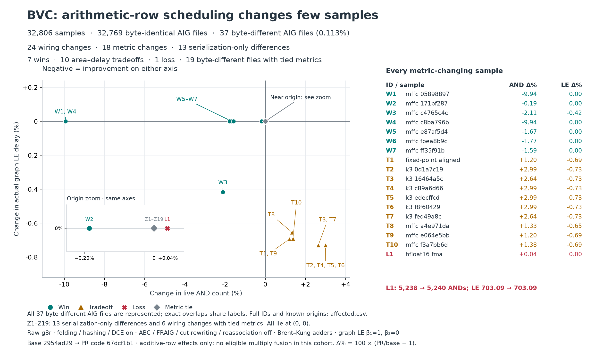

# BVC impact of arithmetic-row scheduling



The full **32,806-sample** BVC cohort has **7 wins, 10 area–delay tradeoffs,
1 loss, and 32,788 metric ties**. Of those ties, 32,769 are byte-identical AIGs;
19 have different serialized AIGs but exactly the same AND count and graph LE.
Thus 37 AIG files differ in bytes (0.113% of the cohort), 24 have wiring changes,
and 18 change either plotted metric (0.055%). The other 13 file differences are
serialization-only. Related cones are separate samples, not independent measures of
workload frequency. This cohort has **no eligible multiply-fusion hits**; these
results measure additive-row effects.

Both axes use `100 * (PR / baseline - 1)`: negative is better. A win improves at
least one metric without worsening the other; a tradeoff improves one and
worsens the other. The only loss is `hfloat16::fma`: 5,238 to 5,240 ANDs
(+0.04%), with graph LE unchanged at 703.09. Exact overlaps share scatter labels;
the table lists all 18 metric-changing samples individually. Z1–Z19 at the origin
comprise 13 serialization-only differences and six wiring changes with tied
metrics. Exact topology comparison preserves input identity, output order, and
inversion edges while ignoring node numbering and commutative AND operand order.
A changed AIG hash alone does not establish changed wiring, gate count, or delay.

## Data and lineage

- [measurements.csv.gz](measurements.csv.gz): all 32,806 raw measurement pairs,
  full sample IDs, and serialized-AIG identity flags; no sampling or rounding.
- [affected.csv](affected.csv): all 37 byte-different AIG files, plot IDs, raw measurements,
  source/AIG hashes, top functions, and known origin functions. Blank origins
  remain unresolved; legacy structural-hash matches are explicitly identified.
- [provenance.json](provenance.json): source, binary, corpus, and input-data
  hashes; exact mapping flags; population checks and limitations.
- [plot.py](plot.py): reproduces the figure and recomputes classifications from
  the complete compressed CSV. It checks that the detailed CSV covers every
  byte-different AIG file.

Baseline: [`2954ad29`](https://github.com/xlsynth/xlsynth-crate/commit/2954ad294eebf990d0ab77eb43370ce9b4c38cf9).
Optimization: [`8354998f`](https://github.com/xlsynth/xlsynth-crate/commit/8354998f4e359d2816bb2b0f9664315267ab8f37),
verified against PR code at
[`67dcf1b1`](https://github.com/xlsynth/xlsynth-crate/commit/67dcf1b1679b1cdb5db7b32aec44f0243af650f9).
The three measured production files are unchanged except for module
documentation; subsequent changes update test expectations and fixture newlines.
This uses the generalized arithmetic-cluster comparison, not the earlier
arrival-boundary-only candidate. The cohort contains 63 whole functions, 31,772
k-cones, and 971 MFFCs from the published 0.74.0 corpus generation (DSO 0.59.0).

Graph LE is `graph_logical_effort_worst_case_delay`, with beta1=1 and beta2=0;
it is **not logic depth**. Measurements are raw g8r with normal local builder
folding, hashing and DCE, before ABC, FRAIG, cut rewriting or reassociation.
Mapping emits an AIG; the frozen baseline's `aig-stats` measures both variants
using the same implementation. Byte-identical AIGs reuse the baseline's exact
statistics. The unchanged rows retain any `-1` undefined-LE sentinel; every
byte-different file has a positive baseline on both axes. Classification uses exact
integer AND counts and an absolute LE tolerance of 1e-8; all 19 byte-different metric
ties are also exactly equal before applying that tolerance.

## Reproduce

```sh
python3 -m venv /tmp/pr1107-bvc-plot
/tmp/pr1107-bvc-plot/bin/pip install matplotlib==3.11.2
/tmp/pr1107-bvc-plot/bin/python docs/benchmarks/pr1107-bvc/plot.py
```

The original mapping commands, run for both baseline and candidate, use these
portable placeholders:

```sh
"$DRIVER" ir2g8r "$IR" --top "$TOP" \
  --adder-mapping=brent-kung --fold=true --hash=true \
  --fraig=false --reassociation=false \
  --enable-formal-array-alias-analysis=false --cut-db-rewrite=false \
  --compute_graph_logical_effort=false --aiger-out sample.aig
"$BASELINE_DRIVER" aig-stats sample.aig --quiet=true \
  --compute-graph-logical-effort=true \
  --graph-logical-effort-beta1=1 --graph-logical-effort-beta2=0
```
